<div align="center">

# NadiSaathi

**नदी साथी, "river friend": a camera reads the river in metres with OpenCV 5 on AWS Graviton4, and an agent warns the next country downstream.**

[](#opencv-5)
[](#aws)
[](#agentic-vision)
[](#mcp-server)
[](LICENSE)
[](https://github.com/Prashant-thakur77/JalRekha/actions/workflows/ci.yml)
[](#built-and-tested)
[](#built-and-tested)
[](https://gaq7chhmb2.execute-api.us-east-1.amazonaws.com)
[](https://youtu.be/eVobF8Eg-b4)

[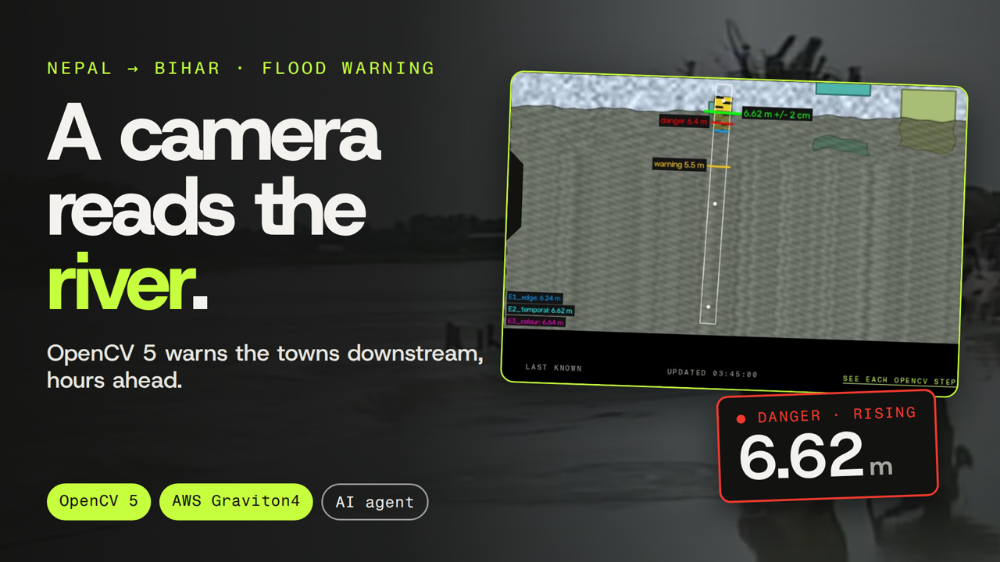](https://youtu.be/eVobF8Eg-b4)

### [Live demo](https://gaq7chhmb2.execute-api.us-east-1.amazonaws.com) · [Video (4:37)](https://youtu.be/eVobF8Eg-b4) · [Report PDF](docs/REPORT.pdf) · [Judges' guide: proof for every track](docs/JUDGES.md)

</div>

## In one minute

**What it does.** A fixed camera looks at a river staff gauge. OpenCV 5 turns each burst of frames into a river level in metres with an error bar. An agent reads that number and decides what to do next: look more often, ask Claude for a second opinion only when its own estimators disagree, work out when the wave reaches each town downstream, and draft short alerts with a voice version and a CAP file. A named person approves every public message with a PIN.

**For whom.** The rivers that rise in Nepal and flood the plains of Bihar and Uttar Pradesh: the Koshi, Gandak, Karnali and Bagmati. A camera at Chatara on the Koshi in Nepal sees the rise first; NadiSaathi turns it into arrival windows for Birpur, Basua and Baltara in Bihar. It is built for a ward disaster focal person on the Nepal side, a district (DDMA) control-room operator on the India side, and the panchayat volunteers and relief teams who work after the water arrives. Alerts are drafted in Nepali, Hindi, Maithili, Bhojpuri and English.

**The demo in one sentence.** Open the [live demo](https://gaq7chhmb2.execute-api.us-east-1.amazonaws.com), press *Run replay* on "Koshi: rise to the peak", watch OpenCV read the river and the agent tighten its checks as the water climbs, then open **Approvals** to find the Hindi and Maithili drafts waiting for a person. The operator PIN is in the submission's testing instructions.

| | |
|---|---|
| Measurement | **10.6 cm** mean error on real USGS staff-gauge cameras, nothing fitted to gauge data |
| Agent | **36/36** scenario runs correct, first alert a median **62 min** before the warning crossing, 0 false-alert runs |
| Guard | **32/32** lying, injected or malformed model replies caught |
| Graviton4 | **99.4 frames/s**, **$0.446** per million frames, outputs identical to x86 |
| Production | **285** agent cycles in CloudWatch, OpenCV **93 ms** per cycle (median) on the c8g host |

## Contents

[Judges' guide](docs/JUDGES.md) · [Sponsor tracks](#sponsor-tracks) · [Screens](#screens) · [Results](#results) · [Built and tested](#built-and-tested) · [Architecture](#architecture) · [Run it](#run-it) · [Versions](#versions) · [Notices and license](#data-and-model-notices)

## Sponsor tracks

| Prize | What it asks for | Where NadiSaathi delivers it |
|---|---|---|
| Overall | OpenCV 5 doing substantive image or video analysis, plus a meaningful AWS component | [OpenCV 5](#opencv-5): a full metric measurement pipeline on every camera burst. [AWS](#aws): one CloudFormation stack on Graviton4 and the managed services around it, measured in production |
| Best Use of COOL | Cloud-Optimized OpenCV on AWS Graviton | [COOL on AWS Graviton](#cool-on-aws-graviton): the OpenCV 5 workload benchmarked on Graviton4 against x86 with identical outputs, KleidiCV active, and a one-flag switch to the COOL AMI |
| Agentic Vision | Image or video results change the agent's next plan, tool call, action or request for human approval | [Agentic vision](#agentic-vision): decision branches D1–D9, each chosen by an OpenCV number, and every public action behind a human PIN |

### OpenCV 5

The measurement engine, JalRekha (जलरेखा, "waterline"), is `backend/src/jalrekha/vision/`: pure OpenCV 5.0.0 and NumPy. It runs on every agent cycle, in the API process on Graviton4.

```
camera burst ─► quality gate ─► registration ─► gauge strip ─► 3 waterline estimators ─► fusion ─► Kalman
 (5 frames)    blur/night/     ORB, rescue     warpAffine     E1 edge energy (Scharr)     weighted  level +
               glare/fog       with ALIKED+    along the      E2 temporal texture (DIS)  median,   rise rate
                               LightGlue       gauge axis     E3 colour step (Lab)       sigma     (m/h)
```

| OpenCV API | File | What it does here |
|---|---|---|
| `cv2.ALIKED_create` + `cv2.LightGlueMatcher_create` (ONNX models on the OpenCV 5 DNN engine) | `register.py` | Re-registers the camera when ORB fails: rain, high water hiding the reference features, a knocked mount (branch D2) |
| `cv2.ORB_create` + `cv2.BFMatcher` (Hamming) | `register.py` | Default registration of each burst to the calibration frame |
| `cv2.estimateAffinePartial2D` (RANSAC) | `register.py` | Rotation, scale and shift from the matches; inliers and residual feed the D2 decision |
| `cv2.phaseCorrelate` + `cv2.createHanningWindow` | `register.py` | Aligns the frames inside a burst against wind shake |
| `cv2.warpAffine` | `gauge.py`, `pipeline.py` | Cuts a rectified strip along the gauge axis; applies the burst alignment |
| `cv2.Laplacian`, `cv2.calcHist`, `cv2.meanStdDev` | `quality.py` | Sharpness, clipped and glare pixels, contrast: the quality gate (D1) |
| `cv2.Scharr` | `waterline.py` | Estimator E1: edge-energy profile down the gauge |
| `cv2.DISOpticalFlow_create`, `cv2.cartToPolar` | `waterline.py`, `flow.py` | Estimator E2: water moves, the gauge does not; also a surface-motion proxy |
| `cv2.cvtColor(..., COLOR_BGR2Lab)` | `waterline.py`, `relief.py` | Estimator E3: the colour step where paint meets water |
| `cv2.KalmanFilter` | `temporal.py` | Level and rise rate in m/h with irregular time steps and a Mahalanobis gate (D4, D5, D9) |
| `cv2.FaceDetectorYN_create` (YuNet) | `privacy.py` | Blurs faces before any frame is stored or shown |
| `cv2.dnn.readNet`, `cv2.dnn.blobFromImage`, `cv2.dnn.NMSBoxes` (LPD-YuNet) | `privacy.py` | Blurs number plates |
| `cv2.GaussianBlur` | `privacy.py`, `waterline.py` | Redaction; smoothing of the estimator profiles |
| `cv2.grabCut`, `cv2.morphologyEx`, `cv2.connectedComponentsWithStats` | `relief.py` | Water mask on a volunteer's road photo and depth at a reference object (D8) |
| `cv2.drawMatches`, `cv2.drawKeypoints`, `cv2.applyColorMap`, `cv2.getBuildInformation` | `explain.py` | Vision Lab: RANSAC inliers, Laplacian heat map, the host's build and HAL lines |

**Accuracy.**

- Real USGS staff-gauge cameras, physical calibration (gauge numerals clicked once, nothing fitted to gauge data): **10.6 cm** mean error (95% CI 7.0–16.1), median **4.1 cm**, 115 frames at two sites. Hancock alone: median 2.5 cm, 89% within 10 cm.
- The original edge heuristic the project started from: 99.2 cm on the 38% of frames it answers; on those same 44 frames the OpenCV pipeline is **16.5 cm**.
- Claude (claude-opus-5-5) reading the same gauges: 14.0 cm on the frames it answered, against **10.0 cm** for OpenCV on those frames, at ~2.5 s and $6.263 per 1,000 frames. OpenCV costs $0.446 per million frames on Graviton4.
- The agent on a real camera through the July 2026 Hancock flood: **6.5 cm** on the 64 readings it used, siren on the first frame above the danger mark, 0 alert drafts on the quiet days.
- Held-out synthetic scenes in rain, fog, night, shake, blur, glare, JPEG and still water: **8.0 cm** (CI 6.9–9.2), 83% within 5 cm, 2,160 frames from 30 scene seeds never used for tuning.

**Vision Lab** (`/vision` in the app) rebuilds any recorded cycle and shows each OpenCV stage with its real images and numbers: the quality metrics and Laplacian map, ORB or ALIKED+LightGlue inliers, the rectified gauge strip, the three estimator profiles on a metre axis, fusion and Kalman, and per-stage timing with the host's OpenCV build.

| Registration: RANSAC inliers and a reference/warped checkerboard | The three waterline estimators on a metre axis |
|---|---|
| 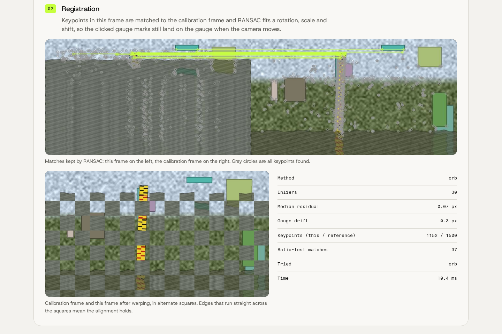 | 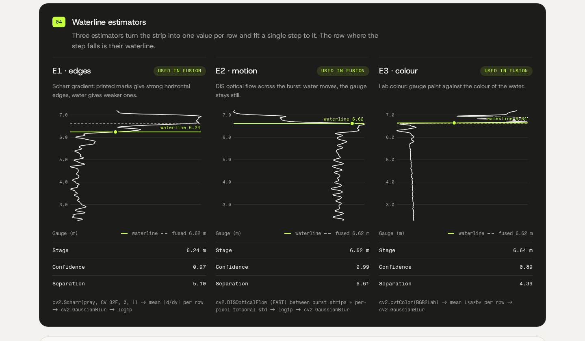 |

**Why it fits the prize:** OpenCV 5 is the measurement itself, not a pre-processing step. Every alert, siren and cadence change starts from a number these APIs produce, and the OpenCV 5 DNN engine runs the ALIKED+LightGlue rescue that keeps a knocked camera usable.

### AWS

One CloudFormation stack, `infra/nadisaathi.yaml`, 36 resources, deployed and updated with `make deploy`.

| Service | What it does here |
|---|---|
| EC2 c8g.xlarge (Graviton4, Ubuntu 24.04 arm64) | FastAPI, the PWA, the OpenCV 5 pipeline and the agent loop; IMDSv2, no SSH (SSM only) |
| API Gateway (HTTP API, VPC link) | The public HTTPS front door, with throttling; the instance port is not public |
| S3 | Evidence archive: every agent cycle's JSON event and blurred overlay, kept 90 days by a lifecycle rule; CAP files; deploy bundles |
| CloudWatch | One JSON event per agent cycle, per-stage OpenCV metrics (`StageMs`), Logs Insights queries, a dashboard and 4 alarms (instance health, public health probe, OpenCV slower than 1 s) |
| SNS | Operator notifications, and SMS after approval to verified test numbers |
| Polly | Hindi and English alert audio (Kajal, neural) |
| Step Functions | A drafted public alert starts a timer; while it waits for a decision, operators are re-notified every 15 minutes, up to three times |
| EventBridge + Lambda | Keep-warm health probe every 5 minutes, with an alarm to SNS |
| SSM Parameter Store | Operator PIN, camera key, model key |
| AWS Budgets | Cost alarm for the stack |
| IAM | Least-privilege instance role scoped to the stack's bucket, topic, log group and metric namespace |

**In production**, read back from CloudWatch Logs Insights by `scripts/cloud_ops_report.py`: over 7 days the stack logged **285 agent cycles** (1,093 frames, 5 camera sites). OpenCV took **93 ms per cycle at the median** on Graviton4 (registration 110.6 ms, face and plate blur 53.1 ms, DIS-flow estimator 6.6 ms on average). ORB aligned 271 cycles with 666 inliers on average, ALIKED+LightGlue rescued 3, and 11 cycles from the camera-knock scenario were held for a person. Claude gave 27 live second opinions at 4.1 s median for $0.21 in total. S3 holds 575 cycle evidence objects. The public health probe: **100.0%** of 275 probes OK over 23.0 h, p50 125 ms.

The **AWS cloud** page (`/cloud`) shows this live: the service states, the CloudWatch log tail of agent cycles, the fixed Logs Insights queries with their query text, and the OpenCV stage metrics.

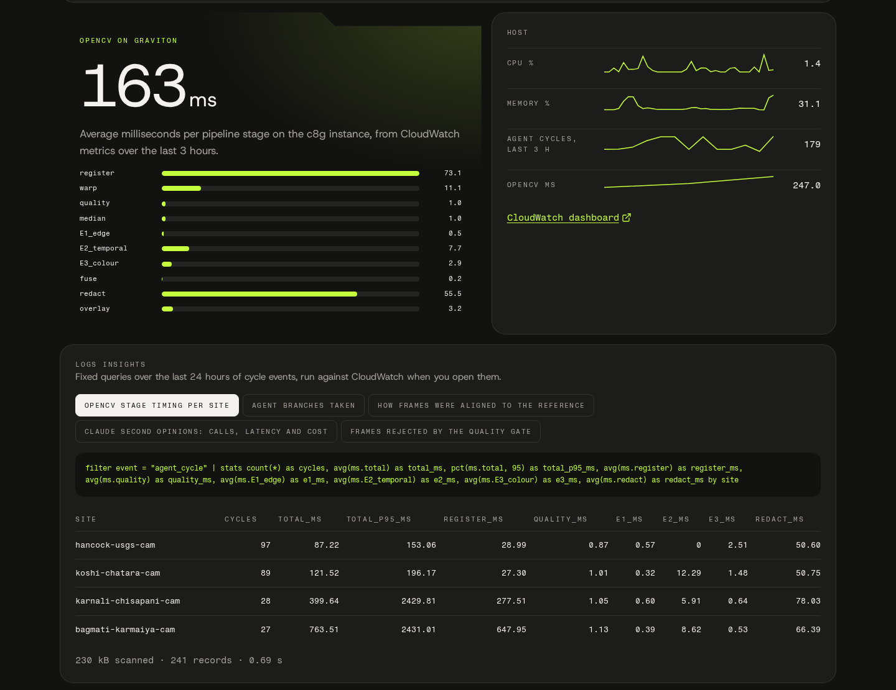

**Why it fits the prize:** AWS is where the system runs and where its evidence lives. The OpenCV pipeline, the agent and the approvals run on Graviton4; every decision is a CloudWatch event and an S3 evidence file; Step Functions follows up on alerts waiting for a person; and the whole stack is one template.

### COOL on AWS Graviton

`bench/cool_bench.py` runs the same camera bursts through the full pipeline on each host, five repeats, and hashes every stage reading rounded to 1 mm. `scripts/bench/cloud_bench.sh` launches each configuration on a temporary EC2 instance and records the instance id, type, AMI and `cv2.getBuildInformation()`.

| Same 4 vCPU, same frames | Graviton4 c8g.xlarge | x86 c7i.xlarge | Graviton4 vs x86 |
|---|---|---|---|
| CPU | Neoverse-V2 | Intel(R) Xeon(R) Platinum 8488C | |
| ms per 5-frame burst (mean of 5, sd) | **87.0** (0.19) | 92.5 (0.40) | 1.06× faster |
| Frames/s, one worker per vCPU | **99.4** | 93.3 | 1.07× |
| Cost per million frames (on-demand) | **$0.446** | $0.531 | **16% cheaper** |
| ALIKED+LightGlue registration, ms | 1,223 | 1,799 | **1.47×** |
| DIS optical flow 960×540, ms | 16.4 | 25.0 | **1.53×** |
| KleidiCV in the OpenCV build | **yes** | no | |
| Output hash (stage readings, 1 mm) | `c8eabe95ed5a` | `c8eabe95ed5a` | **identical** |

- **KleidiCV is active on Graviton4.** The c8g build reports `Custom HAL: YES (carotene (ver 0.0.1) KleidiCV (ver 26.03))`, recorded in `bench/results/B-stock-wheel-c8g.xlarge.json`; the Vision Lab's timing panel shows the same line live from the deployed instance.
- **Capacity per instance.** From the OpenCV cycle time measured on the deployed host (163 ms, CloudWatch) with one vision worker per vCPU, one c8g.xlarge serves about **246 cameras at a 10-second cadence** or 7,380 at a 5-minute cadence, about $0.02 of compute per camera per month ($116 per instance per month on demand).
- **COOL-ready.** `USE_COOL_AMI=true make deploy` switches the stack to the COOL Graviton4 AMI. The benchmark harness carries the COOL configuration as config A (`scripts/bench/cloud_bench.sh A`), which uses the AMI's own OpenCV build; its results land in `bench/results/A-cool-c8g.xlarge.json`, and `make check-numbers` adds them as a column of `docs/COOL.md`.

Full method and per-stage numbers: [`docs/COOL.md`](docs/COOL.md).

**Why it fits the prize:** the workload is an OpenCV 5 pipeline that runs in production on Graviton4, measured against x86 on the same frames with byte-identical outputs, with the Arm-optimised KleidiCV HAL in the build, and the deployment switches to the COOL AMI with one flag.

### Agentic vision

The agent (`backend/src/jalrekha/agent/runner.py`) runs one cycle per camera burst: perceive, assess, plan, guard, act or ask, trace. The OpenCV output picks the branch, and the branch changes the next tool call or action:

| Branch | OpenCV output | Next plan, tool call or action |
|---|---|---|
| D1 | Quality gate fails (night, blur, glare, fog) | No alert from this frame; `request_burst` 5 → 9 frames; a photo request to a volunteer after 2 bad frames in a row |
| D2 | ORB registration fails | `register_heavy`: ALIKED+LightGlue or a keyframe chain; if still lost, site degraded and a recalibration request to a person |
| D3 | Fewer than 2 of 3 estimators within 10 cm, or sigma above 8 cm | `verify_with_vlm`: a Claude second opinion, paid for only now; with no model available, the reading is held |
| D4 | Significant Kalman rise (rate − 1.5·σ ≥ 0.30 m/h) | `set_capture_cadence` up (every 10 → 5 min on the scenario sites); `downstream_eta` bands on the river graph |
| D5 | Stage at warning, or projected to cross within 1.5 h | `draft_alert`: local and cross-border SMS, voice and CAP drafts for the right authority, **sent to the approval inbox** |
| D6 | Danger level, quality OK, 2 of 3 estimators agree | `trigger_siren`: local siren through the guard (the only public action the agent takes alone) |
| D7 | The model's reply contradicts a confident measurement by 30 cm or more, is malformed, or carries instructions | Keep the OpenCV value, **request human review** |
| D8 | GrabCut depth at a reference object of 0.30 m or more on a volunteer's road photo | Route-board "blocked" update **drafted for approval** |
| D9 | Falling for 3 cycles after a peak | Cadence back down; all-clear **proposed for approval** |

On the deployed stack, CloudWatch counted the branches the live agent took: **D1 ×9, D2 ×15, D3 ×26, D4 ×4, D5 ×4, D7 ×4, D9 ×1**. In the scenario suite, the trace shows where vision changed the plan: in `moved-363` at T+60 min a knocked camera's misregistered frame reads high, the baseline without vision gates drafts alerts, and the agent's branch is "camera moved: site degraded, recalibration requested".

**Human approval by PIN.** The agent alone changes what the camera does, calls the second opinion, computes arrival windows, drafts messages and sounds the local siren at danger level. Public SMS, voice, CAP, cross-border notices, all-clears, road status and relief dispatch wait in **Approvals** for a named operator and a PIN, with the evidence (camera stage, filtered stage, rise rate, warning levels, downstream bands) linked to the trace steps that produced it. Edits are kept next to the original draft. Wrong PINs lock out; SMS goes to verified test numbers in this pilot.

**Guard against lying or injected model replies.** Only three JSON keys of a model reply are read; a contradiction of a confident OpenCV measurement goes to a person; numbers in model-written text must come from tool outputs. On 40 scripted replies run through full danger-level agent cycles, the guard caught **32/32** bad replies (contradictions, prompt injections in English, Hindi and Nepali, malformed output; injections alone 12/12), accepted **8/8** honest confirmations, and never cancelled the danger siren. In the app, "Try to fool the guard" lets anyone type a model reply in any language and watch the agent keep the OpenCV value.

**The agent against baselines** (9 flood and 27 no-flood runs on held-out scenes, including camera knocks near the warning level; same OpenCV reading for all three):

| | Agent | Projection rule without vision gates | Threshold agent |
|---|---|---|---|
| Correct runs | **36/36** | 34/36 | 35/36 |
| First alert vs true warning crossing (median) | **62 min before** | 56 min | -4 min |
| False-alert runs | **0** | 2 | 1 |
| On 12 scenes added after the last agent change | **12/12** | 10/12 | 11/12 |

**Live Claude second opinions.** In run `run_088eeb6d61` on the deployed stack, the agent read 88 archived frames of the real Hancock camera and called Claude 25 times when its estimators could not confirm each other: 18 confirmed the OpenCV reading and 7 were held for a person. Every call, with model, latency and cost, is in [`docs/traces/LIVE.md`](docs/traces/LIVE.md) and in CloudWatch.

#### MCP server

`make mcp` starts an MCP server (`backend/src/jalrekha/mcp_server.py`) over the AWS deployment, registered for Claude Code in `.mcp.json`. It has 10 tools: `list_sites`, `river_status`, `downstream_eta`, `explain_reading` (what OpenCV did in a cycle), `agent_trace`, `pending_alerts`, `situation_report`, `run_replay`, `replay_status` and `cloud_insights`. 9 are read-only and `run_replay` starts a replay. **No tool can approve, edit or send an alert**, and `backend/tests/test_mcp_server.py` checks it.

**Why it fits the prize:** each branch is triggered by an OpenCV number and changes a concrete next step: the burst length, the registration method, whether to pay for a model call, the capture cadence, which drafts go to which authority's approval inbox, and whether to ask a person.

## Screens

| Live control room: the camera overlay, the stage in metres, the next check and drafts waiting | Vision Lab: one real agent cycle, stage by stage |
|---|---|
| 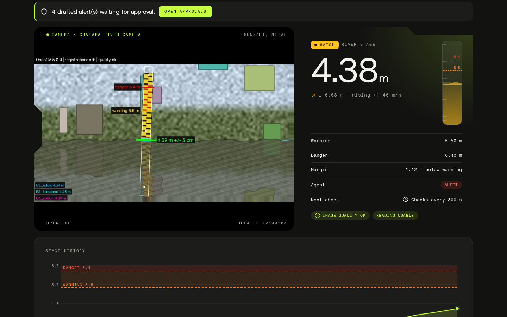 | 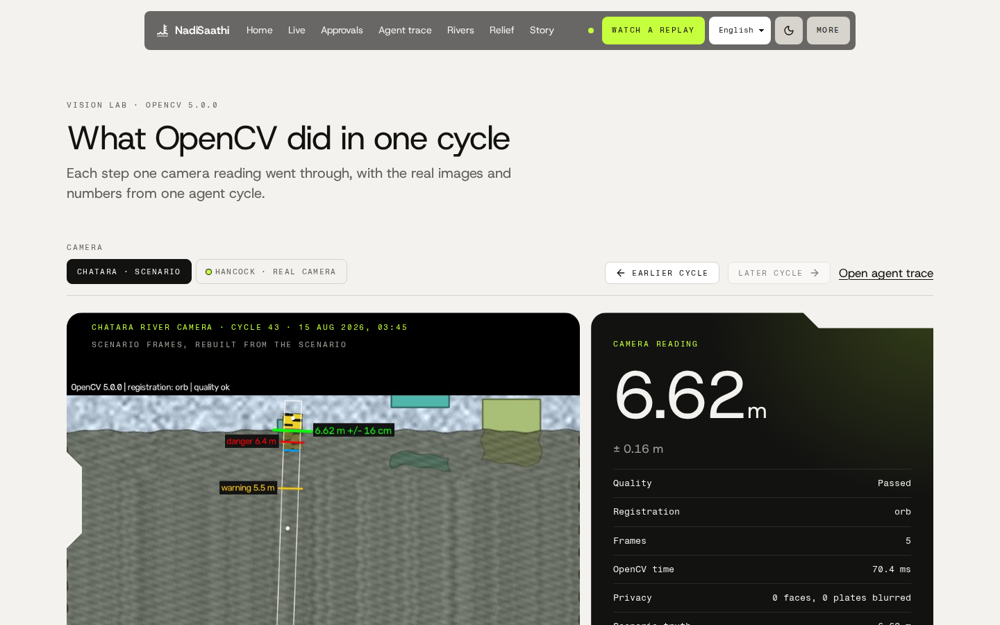 |
| **Approvals: Hindi, Maithili and English drafts with SMS segment counts, voice and CAP** | **Rivers: arrival bands from Chatara across the Nepal–India border** |
| 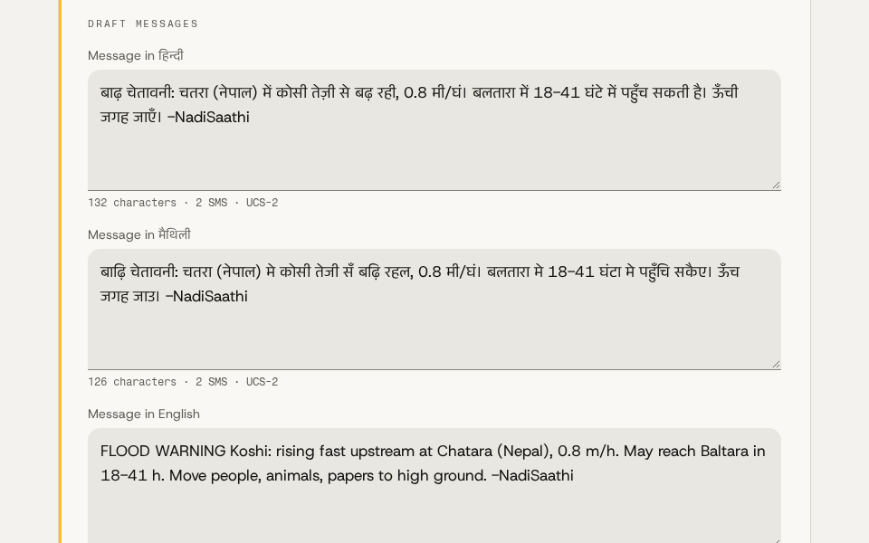 | 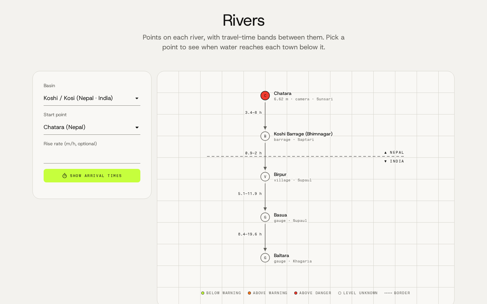 |
| **Relief: requests in Hindi or Nepali, road photo depth check, route board, shelters** | **Story: the Koshi flood night, every figure linked to its source** |
| 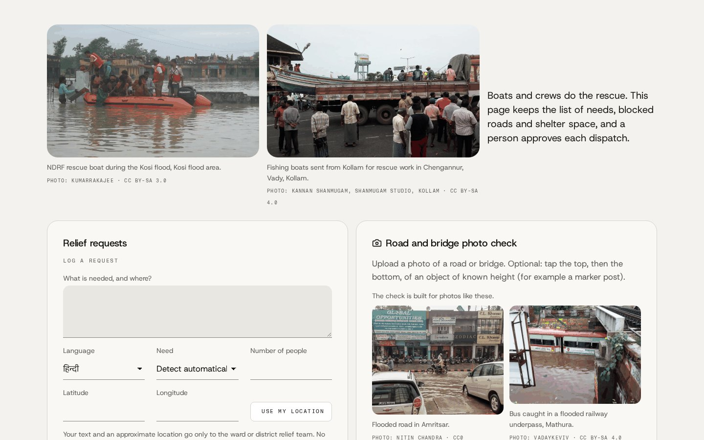 | 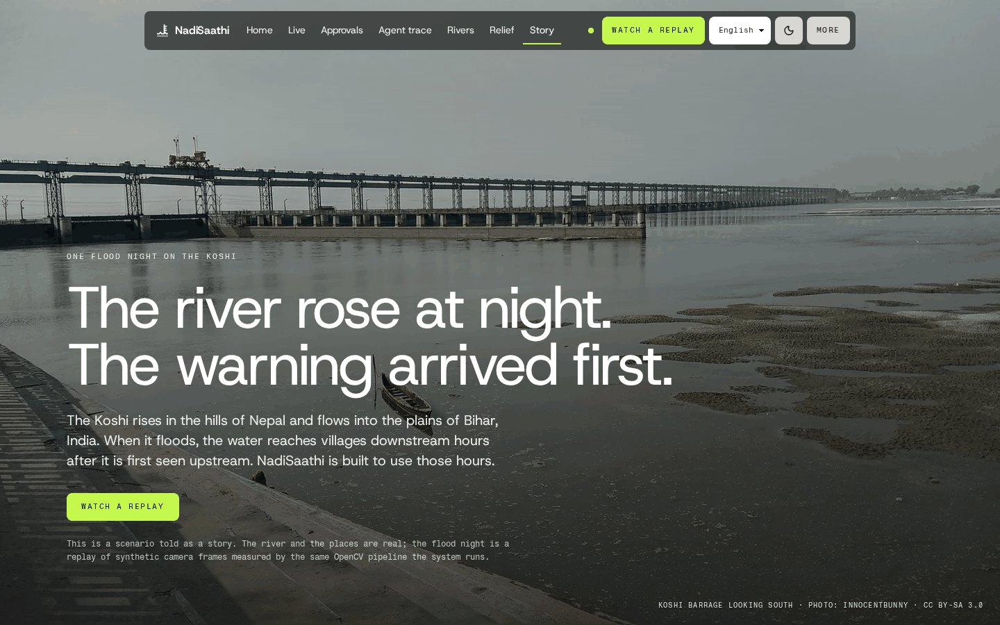 |
| **AWS cloud: services, CloudWatch log and Logs Insights queries** | **On a phone: home, the live control room and an approval card** |
| 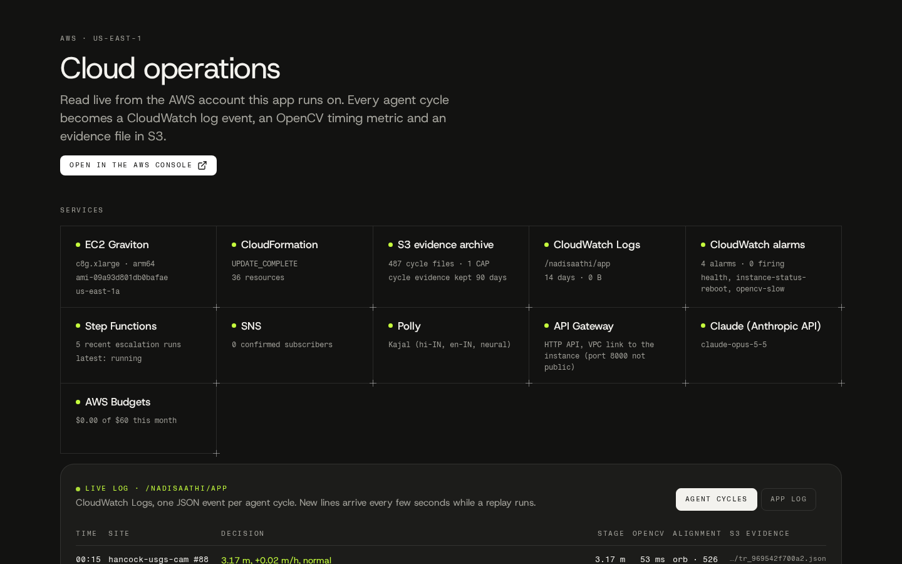 | 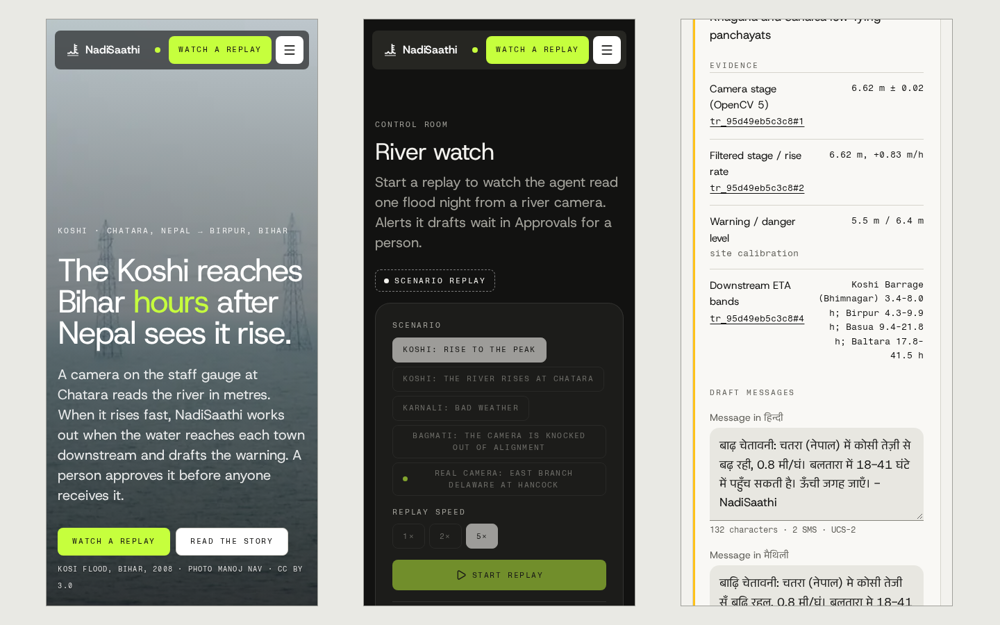 |

Every page in light and dark at 1440 and 390 px: `docs/screenshots/ui/`. The interface is in English, Hindi and Nepali.

## Results

Numbers generated 2026-10-26 15:40 UTC by `scripts/make_headline.py` from `eval/results/*.json` and `bench/results/*.json`. `make check-numbers` fails if this page and the JSON disagree.

| What | NadiSaathi | Baseline | Data |
|---|---|---|---|
| River level on real USGS staff-gauge cameras, physical calibration | **10.6 cm** mean error (95% CI 7.0–16.1), median 4.1 cm | original edge heuristic: answers 38% of frames; on those 44 frames 99.2 cm vs **16.5 cm** for OpenCV; naive max-edge 120.5 cm | REAL, 115 frames, 2 sites |
| OpenCV vs a vision-language model as the gauge reader | OpenCV **10.0 cm** on the frames the model answered, $0.446 per million frames on Graviton4 | claude-opus-5-5: 14.0 cm, answered 72% of frames, ~2.5 s and $6.263 per 1,000 frames | REAL, 115 frames |
| The agent on a real camera (USGS Hancock, July 2026 flood) | **6.5 cm** on the 64 readings it used (median 4.0 cm); siren on the first frame above the danger mark: yes; 0 alert drafts on the quiet days; all-clear proposed: yes | – | REAL, 88 archived frames, illustrative warning/danger marks |
| River level, synthetic scenes in 9 conditions | **8.0 cm** (CI 6.9–9.2), 83% within 5 cm | original heuristic, border-fixed: 74.7 cm | SYNTHETIC, 2,160 frames, 30 held-out scene seeds |
| Lead time from watching the upstream gauge | Percentile warning levels: median **8.5 h** gained, floods flagged before the crossing 8% → **74%**. Official NWS action stages (pre-registered primary): flagged before the crossing 7% → **31%**, mean gain 4.1 h, median 0 min | the same rule on the downstream gauge only | REAL USGS gauge pairs, 8 pairs, held-out 2024–2026 events |
| Agent scenario suite | **36/36** correct, first alert a median **62 min** before the warning crossing, 0 false-alert runs | no vision gates: 34/36, 2 false-alert runs; threshold agent: 35/36, -4 min | SYNTHETIC, 36 runs |
| Guard against a lying or hijacked vision model | **32/32** bad replies caught, 8/8 honest confirmations accepted, danger siren never cancelled | – | SYNTHETIC, 40 scripted replies through full agent cycles |
| Volunteer photo triage on real flood photos from India and Nepal (Claude, after face and plate blur) | flagged **8/8** flooded roads and underpasses, ~3.8 s and $0.014 per photo | – | REAL, 20 licensed Wikimedia Commons photos |
| CV pipeline on Graviton4 vs x86 (same 4 vCPU, same frames, identical outputs) | c8g.xlarge **99.4 frames/s, $0.446 per 1M frames** | c7i.xlarge 93.3 frames/s, $0.531 per 1M frames (16% cheaper on Graviton4) | benchmark workload, `bench/cool_bench.py` |
| Deployed endpoint | **100.0%** of 275 health probes OK over 23.0 h, p50 125 ms / p95 232 ms | – | REAL, CloudWatch |

Evaluation details, protocol and limits: [`docs/REPORT.md`](docs/REPORT.md).

## Built and tested

- **221 tests passing** on the last recorded run (2026-10-25): backend pytest **164 passed** in 27 files (1 expected failure), frontend vitest **57 passed** in 10 files. The counts are written by `scripts/count_tests.py` to `eval/results/tests.json`.
- The tests cover the agent scenarios, approvals and PIN lockout, the guardrails, relief, the photo check, the lead-time code, the MCP server's no-approval rule, and the original API.
- Every measured number in this README, the report, the COOL page and the submission text comes from a result file; `make check-numbers` fails on any mismatch.
- Evaluation scripts, each writing `eval/results/*.json`: `run_real_physical.py` (real cameras), `run_real_replay.py` (agent on a real camera), `run_vlm_baseline.py` (model as gauge reader), `run_stage.py` (synthetic scenes), `run_leadtime.py` and `run_leadtime_v2.py` (real gauge pairs), `run_agent_suite.py`, `run_guard_eval.py`, `run_photo_triage.py`. Protocols are frozen before test runs (`eval/config*.frozen.json`).
- Production: the endpoint answered **100.0%** of 275 health probes over 23.0 h (`scripts/soak_report.py`); `make smoke` calls every original and new API route against the deployed stack.

```bash
make test            # backend pytest + frontend vitest, ESLint and production build
make count-tests     # run both suites, record the counts, regenerate the docs
make eval            # every evaluation -> eval/results/*.json, then the docs
make bench           # the OpenCV benchmark on this machine
make check-numbers   # README, report, COOL page and submission text match the JSON
make smoke           # every API route against the deployed stack
make ops-report      # production numbers from CloudWatch Logs Insights
```

## Architecture

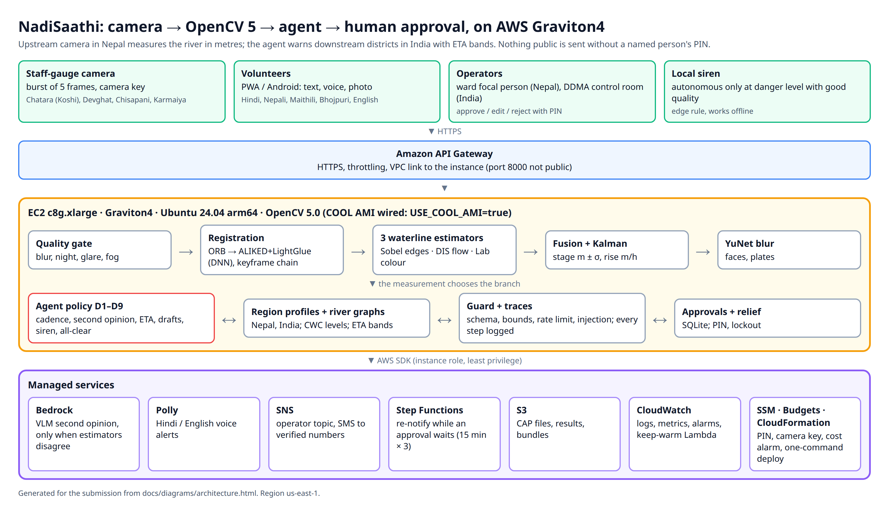

Agent workflow: [`docs/diagrams/agent_workflow.png`](docs/diagrams/agent_workflow.png) (source: [`docs/ARCHITECTURE.md`](docs/ARCHITECTURE.md)).

```
 phone / browser ─► API Gateway HTTPS ─► (VPC link) ─► EC2 c8g.xlarge Graviton4, Ubuntu 24.04 arm64
                                                       FastAPI + PWA, OpenCV 5 worker, agent loop
                                                       │      │        │         │          │
                                         S3 (evidence per  Claude    Polly     SNS        CloudWatch: JSON event
                                         cycle, CAP files, API (VLM  (Hindi/   (operator   per cycle, OpenCV stage
                                         deploy bundles)   2nd op.)  English)  + SMS)      metrics, Insights, alarms
 EventBridge (5 min) ─► Lambda keep-warm ─► /api/health ─► alarm ─► SNS
 Step Functions: a drafted public alert starts a timer (wait 15 min ─► Lambda checks the approval ─► still pending? re-notify, up to 3×)
 SSM Parameter Store (operator PIN), least-privilege instance role, AWS Budgets
 CloudFormation: infra/nadisaathi.yaml   `make deploy` (about 60 s per update)   `make destroy`
```

**Nepal and India, concretely.** Region profiles (`backend/src/jalrekha/regions/data/np.json`, `in.json`) carry the languages, authority roles (ward focal person and municipal EOC in Nepal; DDMA control room, SDMA, panchayat volunteer and NGO team in India), alert channels and CAP settings. River graphs for the Koshi, Gandak, Karnali and Bagmati carry CWC warning and danger levels from the CWC flood-forecasting SOP (April 2025) on the Indian gauge nodes; every travel time that is a distance/celerity estimate says so in the API and the UI. Voice: Amazon Polly Kajal for Hindi and English, an offline espeak-ng voice for Nepali, and a labelled fallback voice for Maithili and Bhojpuri, whose texts are marked for native review. Every fact in the story and the profiles is in `docs/FACTS.md` with its source.

**Responsible use.** NadiSaathi is decision support that complements DHM, CWC, IMD and NDMA warnings. Every public message needs a named person's approval. Faces and number plates are blurred with YuNet before any frame is stored; relief requests keep no names or phone numbers. A frame too poor to read gives "unknown", never "safe". Details: `docs/RESPONSIBLE_USE.md` and `docs/MODEL_CARDS.md`.

```
backend/src/jalrekha/vision/    OpenCV 5 measurement: quality, register, gauge, waterline, fuse, temporal, flow, privacy, relief, explain
backend/src/jalrekha/agent/     agent loop, policy, approvals, scenarios, relief, cloud adapters, guardrails
backend/src/jalrekha/regions/   region profiles (Nepal, India) and river graphs
frontend/src/pages/             Home, Live, Vision Lab, Approvals, Agent trace, Rivers, Relief, Story, AWS cloud, Credits
eval/  bench/  infra/  docs/    evaluations, benchmark, CloudFormation, report and facts
android/                        volunteer app
```

## Run it

```bash
make setup          # backend (uv) + frontend (npm ci)
make dev            # API on :8000, PWA on :5173
make deploy         # AWS stack (docs/DEPLOY.md); USE_COOL_AMI=true selects the COOL AMI; make destroy removes it
```

Scenario replays need no hardware: `POST /api/scenarios/koshi-night-rise/run`. API reference: `docs/API_AGENT.md`.

## Versions

- [v0.1.0](https://github.com/Prashant-thakur77/JalRekha/releases/tag/v0.1.0): camera gauge and agent on AWS Graviton: the OpenCV 5 pipeline, branches D1–D9, river graphs, drafts with PIN approval, one CloudFormation stack.
- [v0.2.0](https://github.com/Prashant-thakur77/JalRekha/releases/tag/v0.2.0): Claude live as second opinion, report and relief parser and photo describer; licensed flood photos from India and Nepal; the new interface in English, Hindi and Nepali.
- [v0.3.0](https://github.com/Prashant-thakur77/JalRekha/releases/tag/v0.3.0): Vision Lab, a CloudWatch event per agent cycle with stage metrics and an S3 evidence archive, and the AWS cloud page.
- [v0.4.0](https://github.com/Prashant-thakur77/JalRekha/releases/tag/v0.4.0): the MCP server, live real-camera traces with Claude second opinions, and the report as a PDF (attached to the release).

## Data and model notices

USGS HIVIS imagery and NWIS gauge data are U.S. public domain (credit: U.S. Geological Survey). Weather data by Open-Meteo.com (CC BY 4.0). OpenCV is Apache-2.0. YuNet face and plate detectors (opencv_zoo), ALIKED (BSD-3-Clause) and LightGlue (Apache-2.0) ONNX weights are downloaded at runtime with SHA-1 checks and are not redistributed here. Gemma model weights, used by the edge components, are under the Gemma Terms of Use and are fetched at runtime.

The flood photos from India and Nepal in the app and in `datasets/india_flood_photos/` are from Wikimedia Commons under public domain, CC0, CC BY and CC BY-SA licences; each photo's author, licence and source are listed in `docs/PHOTO_CREDITS.md`, on the app's Credits page and next to the photo. The web copies are resized and re-encoded; CC BY-SA photos stay under CC BY-SA.

**License:** [MIT](LICENSE).
