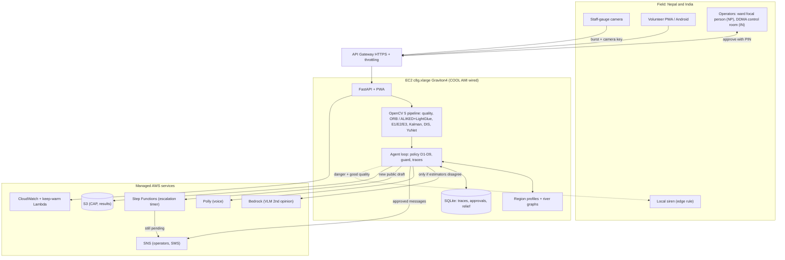
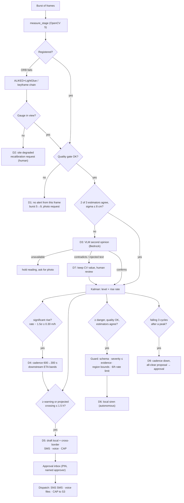

# Architecture

## System

## Agent workflow

Every box writes a step to the trace (`GET /api/agent/traces/{id}`); `docs/traces/README.md` lists the cycles where an OpenCV output changed the next action.
